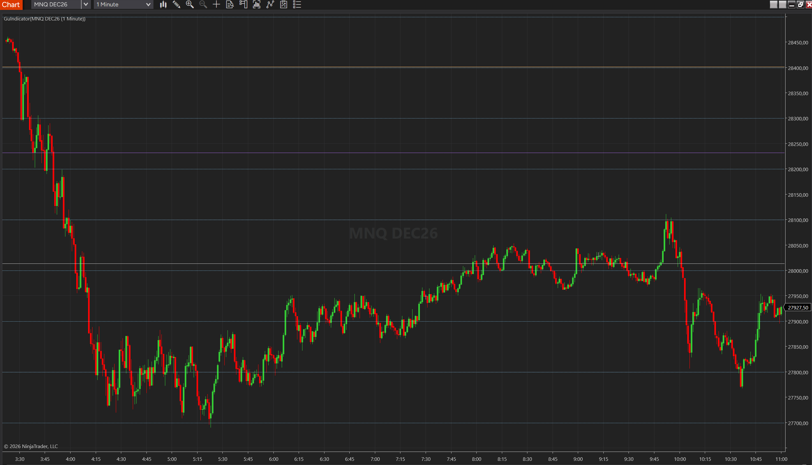

# GuIndicator

Indicador de niveles para **NinjaTrader 8**. / Price-level indicator for **NinjaTrader 8**.

[Español](#español) · [English](#english)

---

## Español

### Qué dibuja

| Nivel | Estilo por defecto | Activo por defecto |
|---|---|---|
| Precios acabados en **00** | Azul claro, discontinua (dash) | No |
| Precios acabados en **50** | Rojo, dash-dot | No |
| **Cierre de la sesión anterior** | Naranja claro, continua | Sí |
| **Máx/mín del día anterior** | Plata, continua | Sí |
| **Máx/mín de la semana anterior** | Morado claro, continua | Sí |
| **Máx/mín del mes anterior** | Morado medio, continua | Sí |

Todas las líneas son de 1 px y ocupan todo el ancho del gráfico.

### Características

- Todo se pinta en `OnRender` (SharpDX), **sin objetos Draw**: no ensucia el gráfico ni la lista de dibujos.
- Solo se calcula el rango de precio visible → ligero aunque haya mucho histórico.
- Las líneas no se pueden seleccionar ni borrar por error.
- Con demasiado zoom out (más de *Máx. líneas visibles*), solo se pintan los niveles 00.
- El periodo inicial incompleto del histórico **no** se pinta (evita máx/mín falsos).
- Tipos de gráfico:
  - Intradía y diario (1 día): todos los niveles.
  - Semanal (1 semana): solo semana anterior.
  - Mensual (1 mes): solo mes anterior.
  - Otros (p. ej. 2 días, anual): solo niveles redondos.

### Instalación

**Opción A – archivo fuente**
1. Copia `GuIndicator.cs` en `Documentos\NinjaTrader 8\bin\Custom\Indicators\`.
2. En NinjaTrader: *New → NinjaScript Editor*, abre `GuIndicator` y pulsa **F5** para compilar.

**Opción B – importar (si hay .zip en Releases)**
1. Descarga el `.zip` de la sección *Releases*.
2. En NinjaTrader: *Tools → Import → NinjaScript Add-On…* y selecciona el `.zip`.

Después: clic derecho en el gráfico → *Indicators…* → **GuIndicator**.

### Parámetros

Los nombres en el panel de propiedades están en inglés:

| Grupo | Parámetro | Defecto | Descripción |
|---|---|---|---|
| Levels | Step (points) | 50 | Distancia entre niveles. Múltiplos pares = nivel 00, impares = nivel 50. |
| Levels | Max visible lines | 200 | Si se supera, solo se pintan los 00. |
| Levels | 50 levels color / 00 levels color | Rojo / Azul claro | |
| Levels | Show 00 levels / Show 50 levels | No / No | Mostrar niveles 00 / 50. |
| Session close | Show previous session close | Sí | Mostrar cierre de la sesión anterior. |
| Session close | Close color | Naranja claro | |
| Previous high/low | Show previous day / week / month high/low | Sí | Mostrar máx/mín del día / semana / mes anterior. |
| Previous high/low | Previous day / week / month color | Plata / Morado claro / Morado medio | |

> Nota: la semana empieza en lunes; día/semana/mes se basan en el *trading day* de la plantilla de sesión del instrumento.

### Requisitos

- NinjaTrader 8 (probado en 8.1.x).

### Aviso

Herramienta visual. No es asesoramiento financiero ni genera señales de trading. Úsalo bajo tu responsabilidad.

---

## English

### What it draws

| Level | Default style | On by default |
|---|---|---|
| Prices ending in **00** | Light blue, dash | No |
| Prices ending in **50** | Red, dash-dot | No |
| **Previous session close** | Light orange, solid | Yes |
| **Previous day high/low** | Silver, solid | Yes |
| **Previous week high/low** | Light purple, solid | Yes |
| **Previous month high/low** | Medium purple, solid | Yes |

All lines are 1 px and span the full chart width.

### Features

- Everything is rendered in `OnRender` (SharpDX), **no Draw objects**: no clutter in the chart's drawing list.
- Only the visible price range is processed → lightweight even with deep history.
- Lines can't be selected or deleted by accident.
- When zoomed out too far (more than *Max. visible lines*), only 00 levels are drawn.
- The incomplete first period of the loaded history is **not** drawn (avoids false highs/lows).
- Chart types:
  - Intraday and daily (1 day): all levels.
  - Weekly (1 week): previous week only.
  - Monthly (1 month): previous month only.
  - Others (e.g. 2 days, yearly): round levels only.

### Installation

**Option A – source file**
1. Copy `GuIndicator.cs` to `Documents\NinjaTrader 8\bin\Custom\Indicators\`.
2. In NinjaTrader: *New → NinjaScript Editor*, open `GuIndicator` and press **F5** to compile.

**Option B – import (if a .zip is available in Releases)**
1. Download the `.zip` from *Releases*.
2. In NinjaTrader: *Tools → Import → NinjaScript Add-On…* and pick the `.zip`.

Then: right-click the chart → *Indicators…* → **GuIndicator**.

### Parameters

| Group | Parameter | Default | Meaning |
|---|---|---|---|
| Levels | Step (points) | 50 | Step between levels. Even multiples = 00 level, odd = 50 level. |
| Levels | Max visible lines | 200 | Above this, only 00 levels are drawn. |
| Levels | 50 levels color / 00 levels color | Red / Light blue | |
| Levels | Show 00 levels / Show 50 levels | Off / Off | |
| Session close | Show previous session close | On | |
| Session close | Close color | Light orange | |
| Previous high/low | Show previous day / week / month high/low | On | |
| Previous high/low | Previous day / week / month color | Silver / Light purple / Medium purple | |

> Note: weeks start on Monday; day/week/month use the trading day from the instrument's session template.

### Requirements

- NinjaTrader 8 (tested on 8.1.x).

### Disclaimer

Visual tool only. Not financial advice and it does not generate trading signals. Use at your own risk.

---

Licencia / License: [MIT](LICENSE)
